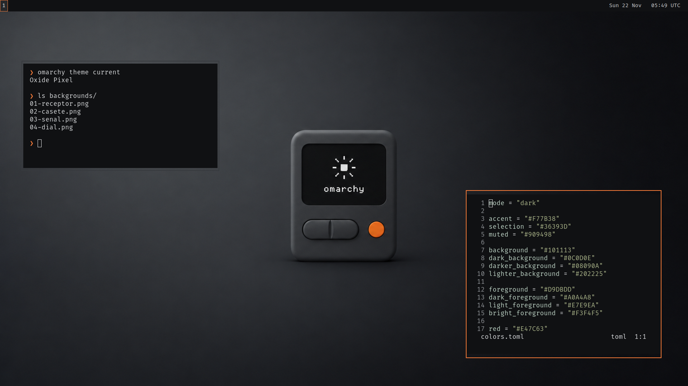
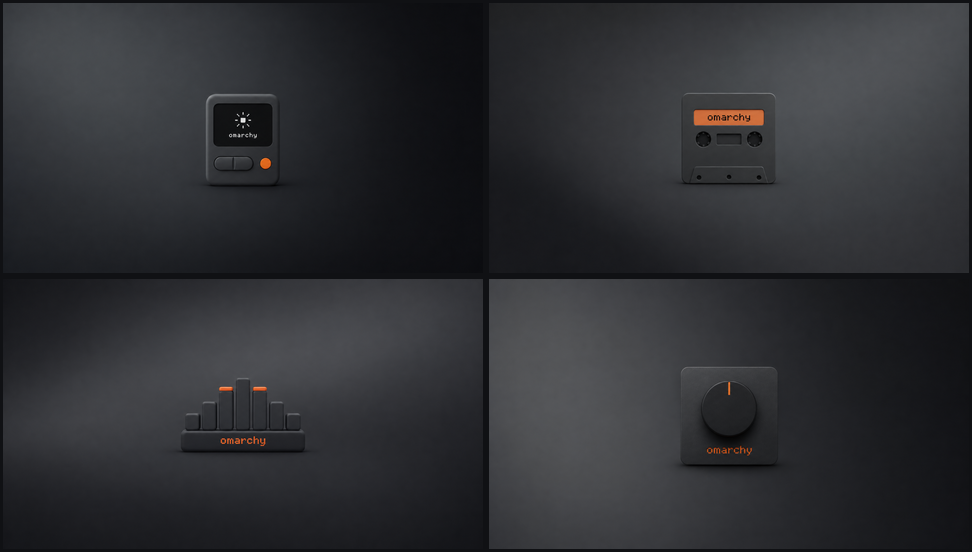

# Oxide Pixel

A dark retrofuturist theme for Omarchy. Matte graphite gives the desktop its depth. A single signal orange picks out a focused window, a button, or the mark on a dial. Each wallpaper features a different piece of pocket hardware with **omarchy** set in pixels.



## Install

Tested on Omarchy 4.5.0. Run this in a terminal:

```sh
omarchy theme install https://github.com/jlopezlira/omarchy-oxide-pixel-theme
```

The installer applies the theme. Use `omarchy theme bg next` to cycle through the four wallpapers. To switch back to it later, run `omarchy theme set oxide-pixel`.

## Four instruments

[](docs/wallpapers.png)

| Wallpaper | Detail |
| --- | --- |
| [Receiver](backgrounds/01-receptor.png) | A pixel sun on smoked glass, a graphite rocker, and a single orange key. |
| [Cassette](backgrounds/02-casete.png) | Two recessed hubs and a burnt-orange label on a matte shell. |
| [Signal](backgrounds/03-senal.png) | Seven raised bars, two orange peaks, and a pixel readout. |
| [Dial](backgrounds/04-dial.png) | A rotary control with an orange index against a soft side light. |

The included PNGs are **1920 × 1080 (16:9)**. For a wider display, [download the four 5120 × 1440 wallpapers (32:9 ZIP)](https://github.com/jlopezlira/omarchy-oxide-pixel-theme/releases/download/v1.0.0/oxide-pixel-ultrawide-5120x1440.zip). Both editions preserve the instruments’ proportions. To use an ultrawide wallpaper, extract the ZIP and pass the path to one of its JPGs to `omarchy theme bg set`.

## The palette

| Role | Color | Where it shows up |
| --- | --- | --- |
| Carbon | `#101113` | Terminal and bar |
| Graphite | `#202225` | Raised surfaces |
| Steel | `#909498` | Secondary text |
| Silver | `#D9DBDD` | Body text |
| Signal orange | `#F77B38` | Focus borders, active controls, and notification countdowns |

Omarchy uses the palette for its generated app themes. The screenshot shows Foot and Neovim with the generated colors. The wallpaper lettering supplies the pixel detail, so you can keep your preferred terminal font.

## Optional notification stack

The standard install includes the notification colors. An optional local adjustment for Omarchy 4.5 puts the newest card in front of a single stack while Oxide Pixel is active. Other themes retain their normal grouping. [Setup and rollback](extras/notifications.md).
